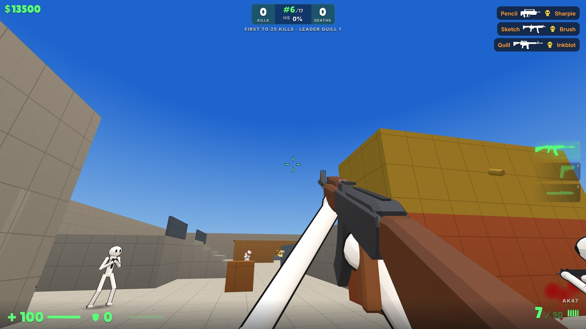

<div align="center">

# STICK SHOOTER

**Classic Counter-Strike gunplay. Stickman simplicity. Zero install.**

A fast, lightweight 3D multiplayer shooter that runs in your browser, on desktop or phone.

### [▶ Play now at stickshooter.kennk.workers.dev](https://stickshooter.kennk.workers.dev)



</div>

---

## Why Stick Shooter

Most browser shooters feel floaty. Stick Shooter is built on the rules that
made Counter-Strike 1.6 a classic: real damage numbers, hitboxes, armor,
wall penetration, spray patterns and movement. It wraps them in a clean,
original look with a white stickman, detailed low-poly guns and bright arenas.

Open a link and you're in a match within seconds. No download, no account,
no launcher.

## Features

**🎯 Gunplay that rewards skill**
- 13 guns at launch, from the USP to the AWP and a spin-up Mini Gun, plus a
  knife and HE grenades. Every number (damage, fire rate, magazine, price)
  matches CS 1.6.
- **Hitboxes**: headshots do 4× damage, stomach 1.25×, legs 0.75×.
- **Armor**: kevlar and helmet, with per-gun armor penetration (the AK lets
  77.5% through, the AWP 97.5%).
- **Wall penetration** by material. Rifles punch through wood and thin metal;
  concrete and containers stop everything.
- **Range falloff**, first-shot accuracy, CS-style recoil and spray, and
  movement inaccuracy. Crouch and walk to tighten your shots.

**💣 Real game modes**
- **Bomb defusal**: plant at site A or B, or defend and defuse.
- **Hostage rescue**: lead the hostages out, or guard them.
- **Deathmatch**: Free for all or Teams (Red vs Blue).
- CS-style rounds with one life, a buy menu, buy time, kill rewards and a
  first-to-8 match. Spectate teammates after you die.
- Multi-kill streaks with announcer calls: DOUBLE, TRIPLE, MULTI, ULTRA,
  **MONSTER KILL**.

**🗺️ Five original maps**

| Map | Mode | Size |
| --- | --- | --- |
| Yard | Deathmatch | Medium |
| Canal | Bomb defusal | Huge |
| Dunes | Bomb defusal | Huge |
| Harbor | Hostage rescue | Large |
| Frost | Hostage rescue | Huge |

All are CS 1.6 scale, with water you can wade, swim and dive in, bridges,
and cover to fight around.

**🤖 Smart bots, up to 128 of them**
- Bots take roles (rush, flank, anchor, lurk), use cover, buy their own
  gear, plant and guard the bomb, and run real team strategies that change
  round to round.
- Easy, Normal and Hard difficulty.
- Fill a server with up to **128 bots** for total chaos.

**🌐 Online multiplayer**
- Hit **PLAY ONLINE** and you're in a live room in seconds.
- The server runs the same game rules as the client at 128 ticks per
  second, so every hit is decided fairly.
- Client prediction and lag compensation make shots land where you aimed.

**📱 Plays on phones too**
- Built-in touch controls for iPhone, iPad and Android: a floating move
  stick, drag to aim, and buttons for fire, jump, crouch, reload, scope,
  grenade, buy and more.

**⚡ Lightweight and smooth**
- About 240 KB of code (gzipped) and roughly 1 MB of sound.
- Uncapped frame rate: 120 Hz and 144 Hz screens get 120 and 144 FPS.
- 128 Hz simulation, raw mouse input and a fully rebindable keyboard.
- Crosshair editor, FOV and sensitivity settings.

## Controls

| Key | Action |
| --- | --- |
| WASD | Move |
| Mouse | Aim |
| Mouse 1 / Mouse 2 | Fire / scope (AWP) |
| Space | Jump |
| Ctrl or C | Crouch |
| Shift | Walk (silent, more accurate) |
| R | Reload |
| 1 / 2 / 3 / 4 / Q | Primary / pistol / knife / grenade / last weapon |
| B | Buy menu (number keys: B 4 3 = M4A1) |
| N | Buy ammo |
| G | Drop or pick up a gun |
| E | Plant or defuse the bomb, lead a hostage |
| Tab | Scoreboard |
| M | Switch team |
| Esc | Pause |
| ~ | Admin console |

Every key except Esc can be rebound in **Settings → Controls**.

## The weapons

| Gun | Damage | Mag | RPM | Wall pen. | Price |
| --- | --- | --- | --- | --- | --- |
| USP | 34 | 12 | 400 | 1 | $500 |
| Desert Eagle | 54 | 7 | 267 | 2 | $650 |
| UZI | 27 | 32 | 857 | 1 | $1250 |
| MP5 | 26 | 30 | 800 | 1 | $1500 |
| UMP45 | 30 | 25 | 600 | 1 | $1700 |
| P90 | 21 | 50 | 909 | 1 | $2350 |
| Shotgun | 9 × 20 | 8 | 69 | 0 | $1700 |
| Auto Shotgun | 6 × 20 | 7 | 240 | 0 | $3000 |
| FAMAS | 30 | 25 | 727 | 2 | $2250 |
| AK47 | 36 | 30 | 628 | 2 | $2500 |
| M4A1 | 33 | 30 | 686 | 2 | $3100 |
| AWP | 115 | 10 | 41 | 3 | $4750 |
| Mini Gun | 30 | 150 | 1091 | 2 | $5750 |

Full damage rules (armor ratios, range modifiers, materials) are in
[docs/DESIGN.md](docs/DESIGN.md).

## Roadmap

- Skins and stickman customization
- iOS app (the touch controls already work in mobile Safari)
- Room browser and private matches
- More maps and weapons

---

## For developers

Built with [Three.js](https://threejs.org) and vanilla JavaScript, bundled
by Vite, hosted on a Cloudflare Worker with a Durable Object per game room.

```bash
npm install
npm run dev         # game at http://localhost:5173
npm run dev:server  # Worker + rooms on :8787 (dev proxies /api and /ws to it)
npm test            # sim, bot and netcode tests
npm run build       # production build in dist/
npm run deploy      # build and deploy to Cloudflare
```

Pushing to `main` deploys automatically through Cloudflare Workers Builds.

### Code layout

```
src/sim/      Game rules: no DOM, no Three.js. Runs in the browser, in Node
              tests and on the server unchanged.
  game.js       Game state, fixed 128 Hz tick, weapons, damage, buying
  movement.js   CS-style movement, collision and swimming
  combat.js     Hitboxes, bullet tracing, wall penetration, armor
  weapons.js    Weapon table (CS 1.6 numbers)
  objective.js  Bomb and hostage rounds
  bot.js        Bot AI (botplan.js team strategies, nav.js A* paths)
  admin.js      Admin console commands
src/maps/     Map definitions (boxes, spawns, sites)
src/client/   Rendering, audio, input, touch controls, HUD
src/net/      Netcode: protocol, prediction, interpolation
worker/       Cloudflare Worker and the GameRoom Durable Object
```

### Online multiplayer

`worker/index.js` handles `/api/*` and `/ws/*`; everything else is the static
game. Each room is a `GameRoom` Durable Object (binding `ROOMS`) running the
same `src/sim` game at 128 Hz and sending 32 Hz snapshots. Clients predict
their own movement and shots, draw other players 100 ms in the past, and the
server rewinds players (up to 200 ms) to what the shooter saw.

- `GET /ws/:room`: WebSocket (quick play uses `public` and `public-teams`)
- `GET /api/rooms`: players in each quick play room
- `POST /api/rooms`: new random room id
- `GET /api/health`

### Admin console

Press **~** in a match and type `help`: `money`, `addbot`, `removebot`,
`bots <n>` (max 128), `difficulty`, `give <gun>`, `heal`, `god`, `slay`,
`map <id>`, `restart`, `players`.

Commands work right away in practice. Online they need the Worker secret
`ADMIN_KEY` (`npx wrangler secret put ADMIN_KEY`); type `login <password>`
once and the browser remembers it. For `wrangler dev`, put `ADMIN_KEY=...`
in `.dev.vars`.

### Credits

Announcer voice lines are original, generated with the Apache-2.0 Kokoro TTS
model and processed with ffmpeg. Gameplay numbers follow Counter-Strike 1.6;
all art, maps and models are original.
